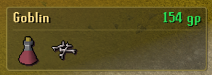
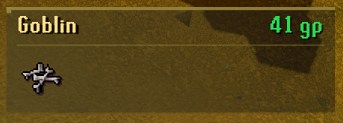
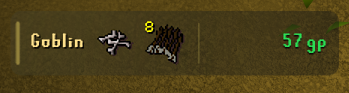

# Loot Pop

A polished RuneLite loot notification overlay with compact layouts, value-based colours and legendary drop effects.

## Features

- Three selectable layouts:
  - **Classic Frame** — compact two-row card with a complete outline.
  - **Minimal Edge** — borderless two-row card with a thin top accent.
  - **Ultra Compact** — a single horizontal row.
- Two background modes for every layout: **Solid** and **Transparent**.
- Uses RuneLite's own item sprites and inventory-style stack quantities.
- Grand Exchange or high-alchemy valuation.
- Smooth configurable fade-out and up to six stacked popups.
- Adjustable scale, colours, opacity, spacing, visible items and value threshold.
- Ground-Items-style value tiers for 20K, 100K, 1M and 10M drops, plus a configurable 100M legendary tier.
- Value-coloured background gradients and content separators in all three layouts and both background modes.
- Optional animated shimmer and particles for legendary drops.
- Optional NPC, boss/event, player and pickpocket loot.
- Source and item ignore lists with wildcard support.
- No external server, API key or data upload.

## In-game styles

| Classic Frame | Minimal Edge | Ultra Compact |
| --- | --- | --- |
|  |  |  |

All three layouts support both **Solid** and **Transparent** backgrounds. Screenshots were captured directly in RuneLite using live OSRS item sprites and values.

## Controls

Open RuneLite settings and search for **Loot Pop**. Hold Alt while dragging the overlay to place it anywhere on the game viewport. While holding Alt, drag a corner handle to resize the complete popup without stretching the item sprites.

The **Value colours** section controls every price boundary, tier colour, gradient strength, separator and legendary effect. The default progression is sky blue at 20K, green at 100K, orange at 1M, pink at 10M and gold with effects at 100M.

The **Popup style** and **Background** settings provide six visual combinations:

| Popup style | Solid | Transparent |
| --- | --- | --- |
| Classic Frame | Yes | Yes |
| Minimal Edge | Yes | Yes |
| Ultra Compact | Yes | Yes |

## Development

The project targets Java 11 and the current RuneLite release.

    .\gradlew.bat test
    .\gradlew.bat run

The development client must be tested manually in-game. The plugin displays information only and does not automate player input.

## Attribution

The event-handling approach was checked against the reviewed Plugin Hub revision of [DevMisery/LootHUD](https://github.com/DevMisery/LootHUD/tree/a0293870c2f4e318be016e6a904c0126ff169886). The rendering, layouts, settings and implementation in this repository are original.

## License

BSD-2-Clause
