<p align="center">
  
</p>

<h1 align="center">Loot Pop</h1>

<p align="center">
  A compact, value-aware loot popup for RuneLite.<br>
  See every drop instantly without giving up valuable game-screen space.
</p>

<p align="center">
  
  
  
  
</p>

## Three distinct popup styles

Every layout supports both **Solid** and **Transparent** backgrounds, configurable opacity, value colours and scaling.

<table>
  <tr>
    <th>Classic Frame</th>
    <th>Rugged Panel</th>
    <th>Loot Strip</th>
  </tr>
  <tr>
    <td align="center">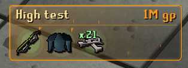</td>
    <td align="center">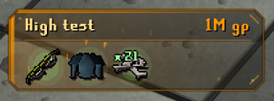</td>
    <td align="center">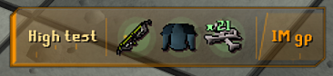</td>
  </tr>
  <tr>
    <td align="center">Balanced two-row layout with a clean full outline.</td>
    <td align="center">Reinforced cut corners, dark header and tier-coloured hardware.</td>
    <td align="center">Fast horizontal layout with separate source, item and value modules.</td>
  </tr>
</table>

## Value tiers in motion

Enhanced mode gives each value tier its own visual language. Thresholds, colours and individual effects are fully configurable.

<table>
  <tr>
    <th>Low · 20K</th>
    <th>Medium · 100K</th>
  </tr>
  <tr>
    <td align="center"></td>
    <td align="center"></td>
  </tr>
  <tr>
    <th>High · 1M</th>
    <th>Insane · 10M</th>
  </tr>
  <tr>
    <td align="center"></td>
    <td align="center"></td>
  </tr>
  <tr>
    <th colspan="2">Legendary · 100M</th>
  </tr>
  <tr>
    <td colspan="2" align="center">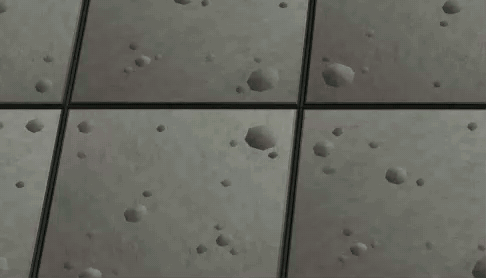</td>
  </tr>
</table>

Legendary drops break beyond the popup frame with a crimson light pillar, energy rain, crown star, rotating rays, shockwaves and an impact burst. Every tier effect is enabled by default and can be disabled separately.

## Pick your experience

Loot Pop includes two complete experience modes. Both retain the essential loot information; only the presentation cost changes.

| | **Performance** | **Enhanced** |
| --- | --- | --- |
| Best for | Maximum FPS and low visual noise | Full presentation and rare-drop excitement |
| Compact loot popups | Yes | Yes |
| Combined item stacks and coloured `xN` labels | Yes | Yes |
| Value tiers and item hover details | Yes | Yes |
| Wiki drop chance and rarity tiers | Yes | Yes |
| Glass treatment and item glows | No | Yes |
| Animated tier particles | No | Yes |
| High, Insane and Legendary sound cues | No | Yes |

**Performance** keeps the lightweight behaviour of the original release while retaining every core usability feature. **Enhanced** adds glass, colour-reactive lighting, particles, item glows and layered rare-drop sounds. Change modes at any time from the plugin settings.

## Sealed Drop reveals

In **Enhanced** mode, Sealed Drop reveals eligible rare items before showing the rest of the loot. Confirmed new Collection Log unlocks receive a gold reveal, even when the item itself is common.

Choose the minimum rarity and reveal speed in **Sealed Drop** settings, or use the sidebar gear for a quick toggle. Click a reveal to skip it. Performance mode remains instant, and Reduce Motion uses brief fades. The popup's reading time begins after the reveal finishes.

To preview it, open **Sound & testing**, choose **Sealed Drop: two rare items** or **Collection Log: common item**, and enable **Show test popup**. Test drops do not enter your real Journal.

<p align="center">
  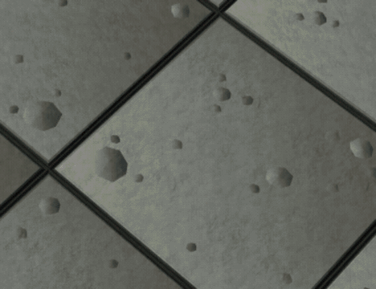
</p>

<p align="center"><em>Recorded with the built-in test scenario; items, chances and values are simulated.</em></p>

<table>
  <tr>
    <th>Sealed reward</th>
    <th>New Collection Log slot</th>
  </tr>
  <tr>
    <td align="center">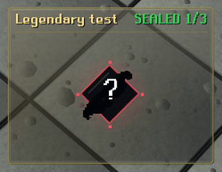</td>
    <td align="center">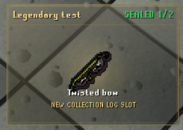</td>
  </tr>
</table>

## New in 1.3.0

Rare rewards now have their own reveal. This update also adds saved loot history and new ways to look back at a session.

- **Sealed Drop:** optional rare-item reveals in Enhanced mode, with a special treatment for new Collection Log unlocks.
- **Collection Log reveals:** a dedicated reveal for confirmed new unlocks, including common items.
- **Loot Journal:** saved, per-character history with date navigation, source filters and Separate or Grouped views.
- **Trophy Shelf:** a separate home for source bests, Ultra rare drops and new Collection Log unlocks.
- **Session Recap:** your total, best drop, top item and other highlights in one place.
- **Source Profiles:** open a source name to explore its saved drops and records.
- **Sidebar improvements:** clearer text, scrollable history, right-click actions and a safer Session Reset.

See the [1.3.0 changelog](CHANGELOG.md#130) for the full changes since 1.2.0.

## Session and source highlights

Choose **Session recap** for an overview across the current session's sources, including the best fully priced drop, most valuable item stack, rarest known drop and Collection Log highlights. Highlights remain available after entries leave Recent Loot. Session time includes idle time; it is not an active-play timer.

Click a source name for its **Source Profile**, based on retained Journal observations and trophies. Both pages let you switch between GE and HA without combining them. These are recorded loot totals, not all-time kill counts or net profit.

**Session Reset** clears the current session and recap, not the saved Journal. Changing characters or restarting the plugin also starts a new recap. Clearing the Journal is a separate, confirmed action and includes its trophies and records.

<table>
  <tr>
    <th>Session</th>
    <th>Session Recap</th>
    <th>Source Profile</th>
  </tr>
  <tr>
    <td align="center">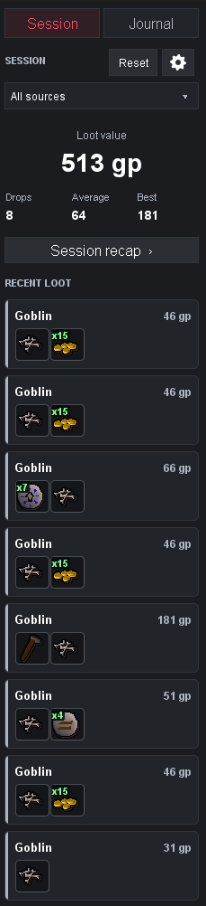</td>
    <td align="center">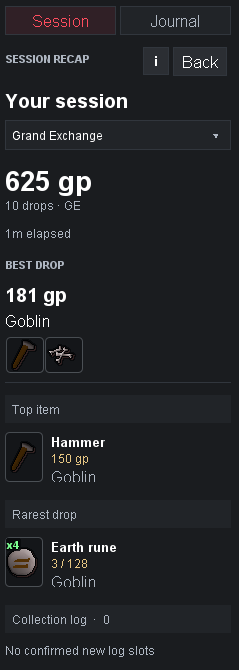</td>
    <td align="center">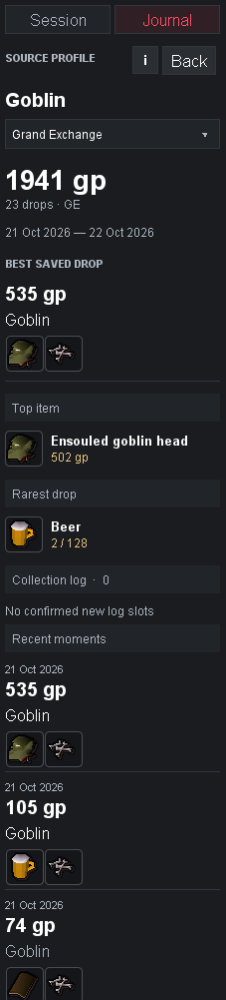</td>
  </tr>
  <tr>
    <td align="center">A quick overview while you play.</td>
    <td align="center">The session's highlights in one place.</td>
    <td align="center">Saved observations for one source.</td>
  </tr>
</table>

## Your loot, saved locally

Open **Journal** to browse recorded drops by date. Use **Filters** to choose a source, price mode or view, or jump straight to a saved date. Dates open independently, so you can compare several days without losing your place.

**Separate** keeps each drop in its own card. **Grouped** combines items within each date using the current filters and their recorded values. It does not merge live popups or reprice old drops. GE and HA observations stay separate.

The Journal also includes **Moments**, **Records** and a **Trophy Shelf**. Trophies have a separate storage limit and no age expiry; when the shelf fills up, the oldest trophies leave first. A better source best replaces the previous best-only trophy, while rare drops and Collection Log unlocks can remain.

Saving is enabled by default, with up to **2,000 drops / 90 days** of ordinary history and **500 trophies**. Change these limits in Loot Journal settings. Only observed drops are recorded—not every kill, loot from before installation or another plugin's history.

<table>
  <tr>
    <th>Separate</th>
    <th>Grouped</th>
  </tr>
  <tr>
    <td align="center">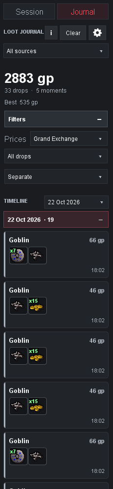</td>
    <td align="center">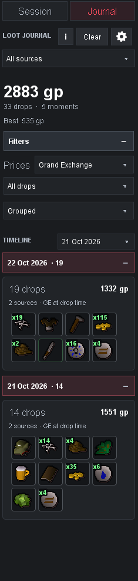</td>
  </tr>
  <tr>
    <td align="center">Browse each drop with its recorded value and time.</td>
    <td align="center">See a day's items and quantities together.</td>
  </tr>
</table>

## When a price is missing

A missing GE quote is not counted as zero or replaced with an HA price. Partly priced drops show a known subtotal such as `100K+ gp`; drops with no known total show **Price pending**. Incomplete drops cannot set personal bests, and incomplete session averages are withheld.

The Journal keeps the values and missing-price state observed at drop time rather than filling old entries with later market prices.

## Highlights

- Combines duplicate entries from the same drop into one icon and one total quantity.
- Uses natural RuneScape-style `xN` labels coloured by the complete value of each item stack.
- Prevents long quantities and coin values from overlapping neighbouring items.
- Shows native RuneLite hover details with item name, quantity, GE, HA, stack value and Wiki drop chance.
- Supports Grand Exchange or high-alchemy valuation.
- Provides configurable visible time and fade-out duration.
- Displays up to six simultaneous popups with adjustable spacing and item limits.
- Adds a hoverable `+N` indicator when a drop contains more items than the visible limit.
- Includes distinct optional sound cues for High, Insane and Legendary drops.
- Provides built-in test popups for every value tier—no rare drop required.
- Supports NPC, boss/event, player and pickpocket loot.
- Includes source and item ignore lists with wildcard support.
- Starts beside the inventory area and remains movable and resizable through RuneLite's overlay controls.

## Controls and configuration

Open RuneLite settings and search for **Loot Pop**.

- **Appearance:** experience mode, popup style, background, scale and visible items.
- **Behaviour:** full-visibility time, fade duration, popup spacing, simultaneous popup count, hover pause and queued kills.
- **Loot filters:** minimum value, loot sources and ignore lists.
- **Value colours:** custom thresholds and colours for every tier.
- **Drop rarity:** independent rate thresholds, lucky marker and an Ultra-rare animated item glow.
- **Sealed Drop:** rare-item reveals, Collection Log reveals and animation speed.
- **Hover details:** Compact, Detailed or fully Custom information presets.
- **Tier effects:** enable effects per tier and adjust their global intensity.
- **Accessibility:** reduce motion, high-contrast text and a colourblind-safe rarity palette.
- **Sound & testing:** rare-drop audio, volume and instant tier previews.
- **Rare screenshots:** optional local capture with independent rarity and total-value thresholds.
- **Side panel:** configurable recent-loot history size plus quick access to the main display controls.
- **Loot Journal:** local history saving, retention limits, Trophy Shelf capacity, layout and personal-best banners.

Hold <kbd>Alt</kbd> while dragging the overlay to reposition it. While holding <kbd>Alt</kbd>, drag a corner handle to resize the complete popup without stretching the item sprites. RuneLite preserves the chosen position and size.

## Installation

1. Open RuneLite.
2. Open the **Plugin Hub**.
3. Search for **Loot Pop**.
4. Select **Install**.

Plugin updates are delivered through the RuneLite Plugin Hub after review.

## Privacy and fair play

Loot Pop is display-only. The installed plugin does not automate game input, make background network requests, upload data or require an API key. Item sprites and pricing data come from RuneLite's existing APIs. Drop chances are read from a bundled OSRS Wiki data snapshot, so hover details remain fully offline while playing. Item links and explicit Open Wiki actions open an OSRS Wiki search in the player's browser. Copy name writes only the chosen item name to the clipboard when requested. Optional rare-drop screenshots are saved locally through RuneLite's own screenshot service and are disabled by default.

Journal metadata is stored in the RuneLite user directory under `loot-pop-journal/`, separately per character, with hashed filenames. It contains no credentials or item images and is not uploaded. Disabling saving keeps existing files; Session Reset does not erase them. Saves retain a previous-file backup, and an unreadable journal is left untouched with a visible error.

## Development

The project targets Java 11 and the current RuneLite release.

```powershell
.\gradlew.bat test
.\gradlew.bat run
```

The development client must be tested manually in-game.

The repository's weekly GitHub Actions workflow checks the OSRS Wiki data after the normal Wednesday update and opens a reviewable pull request only when the bundled snapshot changes. This maintenance runs on GitHub—not inside the RuneLite client—and sends no player data.

## Attribution

The event-handling approach was checked against the reviewed Plugin Hub revision of [DevMisery/LootHUD](https://github.com/DevMisery/LootHUD/tree/a0293870c2f4e318be016e6a904c0126ff169886). The rendering, layouts, effects, settings and implementation in this repository are original. Bundled drop-rate data attribution and crawler licensing are documented in [THIRD_PARTY_NOTICES.md](THIRD_PARTY_NOTICES.md).

## License

Loot Pop is available under the [BSD 2-Clause License](LICENSE).
