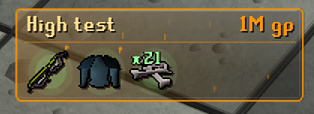
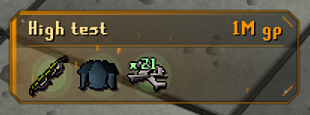
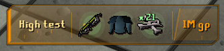
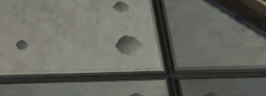
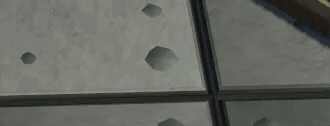
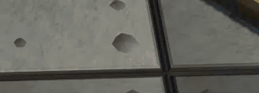
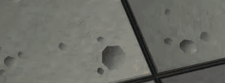
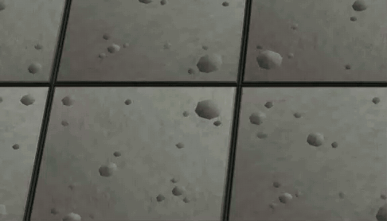

<p align="center">
  
</p>

<h1 align="center">Loot Pop</h1>

<p align="center">
  A compact, value-aware loot popup for RuneLite.<br>
  See every drop instantly without giving up valuable game-screen space.
</p>

<p align="center">
  
  
  
  
</p>

## Pick your experience

Loot Pop includes two complete experience modes. Both retain the essential loot information; only the presentation cost changes.

| | **Performance** | **Enhanced** |
| --- | --- | --- |
| Best for | Maximum FPS and low visual noise | Full presentation and rare-drop excitement |
| Compact loot popups | Yes | Yes |
| Combined item stacks and coloured `xN` labels | Yes | Yes |
| Value tiers and item hover details | Yes | Yes |
| Wiki drop chance and rarity tiers | Yes | Yes |
| Glass treatment and item glows | No | Yes |
| Animated tier particles | No | Yes |
| High, Insane and Legendary sound cues | No | Yes |

**Performance** keeps the lightweight behaviour of the original release while retaining every core usability feature. **Enhanced** adds glass, colour-reactive lighting, particles, item glows and layered rare-drop sounds. Change modes at any time from the plugin settings.

## New in 1.2.0

- Adds an offline OSRS Wiki drop-rate database with automatic weekly maintenance after the usual game update.
- Classifies drops as Common, Uncommon, Rare, Very rare or Ultra rare independently from their GP value.
- Marks lucky drops and gives Ultra rare items a powerful animated glow in Enhanced mode.
- Adds Compact, Detailed and Custom hover presets with concise quantity, GE, HA, stack value and drop-chance rows.
- Adds smart two-row item layout to Classic Frame and Rugged Panel while keeping Loot Strip compact.
- Makes the `+N` overflow badge hoverable so hidden drops remain inspectable.
- Adds test scenarios for one popup, three separate kills and crowded drops.
- Adds Reduce Motion, high-contrast text and a colourblind-safe rarity palette.
- Keeps each defeated monster in its own popup; notifications are never merged across kills.
- Pauses a popup's lifetime while it is hovered so details never disappear mid-read.
- Queues rapid consecutive kills when the visible stack is full instead of immediately discarding their popups.
- Adds a smooth Enhanced-mode slide, scale and staggered item reveal that respects Reduce Motion.
- Keeps the configured visible time as a minimum, then gives Rare and Ultra rare drops extra time automatically.
- Can optionally save local RuneLite screenshots for configurable rarity or GP thresholds.
- Marks new Collection Log unlocks directly on the matching popup.
- Adds a polished side panel with quick controls, item-image loot history and session statistics.
- Gives every recent-loot item image its own compact hover with name, quantity, GE, HA, stack value and drop chance.
- Shows stack quantities directly on Side Panel item icons and opens the matching OSRS Wiki page when an item or source name is clicked.
- Filters session statistics by All sources or an individual boss/NPC encountered during the session.

## Three distinct popup styles

Every layout supports both **Solid** and **Transparent** backgrounds, configurable opacity, value colours and scaling.

<table>
  <tr>
    <th>Classic Frame</th>
    <th>Rugged Panel</th>
    <th>Loot Strip</th>
  </tr>
  <tr>
    <td align="center"></td>
    <td align="center"></td>
    <td align="center"></td>
  </tr>
  <tr>
    <td align="center">Balanced two-row layout with a clean full outline.</td>
    <td align="center">Reinforced cut corners, dark header and tier-coloured hardware.</td>
    <td align="center">Fast horizontal layout with separate source, item and value modules.</td>
  </tr>
</table>

## Value tiers in motion

Enhanced mode gives each value tier its own visual language. Thresholds, colours and individual effects are fully configurable.

<table>
  <tr>
    <th>Low · 20K</th>
    <th>Medium · 100K</th>
  </tr>
  <tr>
    <td align="center"></td>
    <td align="center"></td>
  </tr>
  <tr>
    <th>High · 1M</th>
    <th>Insane · 10M</th>
  </tr>
  <tr>
    <td align="center"></td>
    <td align="center"></td>
  </tr>
  <tr>
    <th colspan="2">Legendary · 100M</th>
  </tr>
  <tr>
    <td colspan="2" align="center"></td>
  </tr>
</table>

Legendary drops break beyond the popup frame with a crimson light pillar, energy rain, crown star, rotating rays, shockwaves and an impact burst. Every tier effect is enabled by default and can be disabled separately.

## Highlights

- Combines duplicate entries from the same drop into one icon and one total quantity.
- Uses natural RuneScape-style `xN` labels coloured by the complete value of each item stack.
- Prevents long quantities and coin values from overlapping neighbouring items.
- Shows native RuneLite hover details with item name, quantity, GE, HA, stack value and Wiki drop chance.
- Supports Grand Exchange or high-alchemy valuation.
- Provides configurable visible time and fade-out duration.
- Displays up to six simultaneous popups with adjustable spacing and item limits.
- Adds a hoverable `+N` indicator when a drop contains more items than the visible limit.
- Includes distinct optional sound cues for High, Insane and Legendary drops.
- Provides built-in test popups for every value tier—no rare drop required.
- Supports NPC, boss/event, player and pickpocket loot.
- Includes source and item ignore lists with wildcard support.
- Starts beside the inventory area and remains movable and resizable through RuneLite's overlay controls.

## Controls and configuration

Open RuneLite settings and search for **Loot Pop**.

- **Appearance:** experience mode, popup style, background, scale and visible items.
- **Behaviour:** full-visibility time, fade duration, popup spacing, simultaneous popup count, hover pause and queued kills.
- **Loot filters:** minimum value, loot sources and ignore lists.
- **Value colours:** custom thresholds and colours for every tier.
- **Drop rarity:** independent rate thresholds, lucky marker and an Ultra-rare animated item glow.
- **Hover details:** Compact, Detailed or fully Custom information presets.
- **Tier effects:** enable effects per tier and adjust their global intensity.
- **Accessibility:** reduce motion, high-contrast text and a colourblind-safe rarity palette.
- **Sound & testing:** rare-drop audio, volume and instant tier previews.
- **Rare screenshots:** optional local capture with independent rarity and total-value thresholds.
- **Side panel:** configurable recent-loot history size plus quick access to the main display controls.

Hold <kbd>Alt</kbd> while dragging the overlay to reposition it. While holding <kbd>Alt</kbd>, drag a corner handle to resize the complete popup without stretching the item sprites. RuneLite preserves the chosen position and size.

## Installation

1. Open RuneLite.
2. Open the **Plugin Hub**.
3. Search for **Loot Pop**.
4. Select **Install**.

Plugin updates are delivered through the RuneLite Plugin Hub after review.

## Privacy and fair play

Loot Pop is display-only. The installed plugin does not automate game input, make background network requests, upload data or require an API key. Item sprites and pricing data come from RuneLite's existing APIs. Drop chances are read from a bundled OSRS Wiki data snapshot, so hover details remain fully offline while playing. Clicking an item or source in the Side Panel explicitly opens an OSRS Wiki search in the player's browser. Optional rare-drop screenshots are saved locally through RuneLite's own screenshot service and are disabled by default.

## Development

The project targets Java 11 and the current RuneLite release.

```powershell
.\gradlew.bat test
.\gradlew.bat run
```

The development client must be tested manually in-game.

The repository's weekly GitHub Actions workflow checks the OSRS Wiki data after the normal Wednesday update and opens a reviewable pull request only when the bundled snapshot changes. This maintenance runs on GitHub—not inside the RuneLite client—and sends no player data.

## Attribution

The event-handling approach was checked against the reviewed Plugin Hub revision of [DevMisery/LootHUD](https://github.com/DevMisery/LootHUD/tree/a0293870c2f4e318be016e6a904c0126ff169886). The rendering, layouts, effects, settings and implementation in this repository are original. Bundled drop-rate data attribution and crawler licensing are documented in [THIRD_PARTY_NOTICES.md](THIRD_PARTY_NOTICES.md).

## License

Loot Pop is available under the [BSD 2-Clause License](LICENSE).
